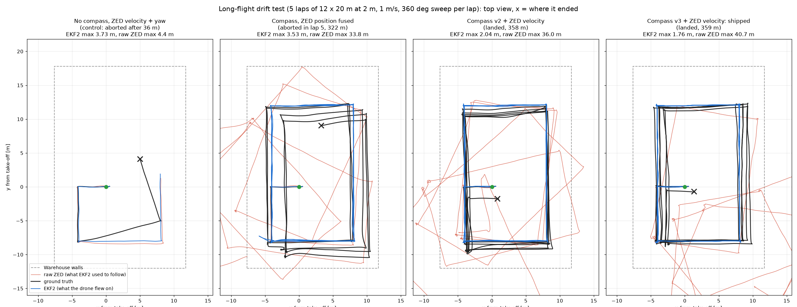
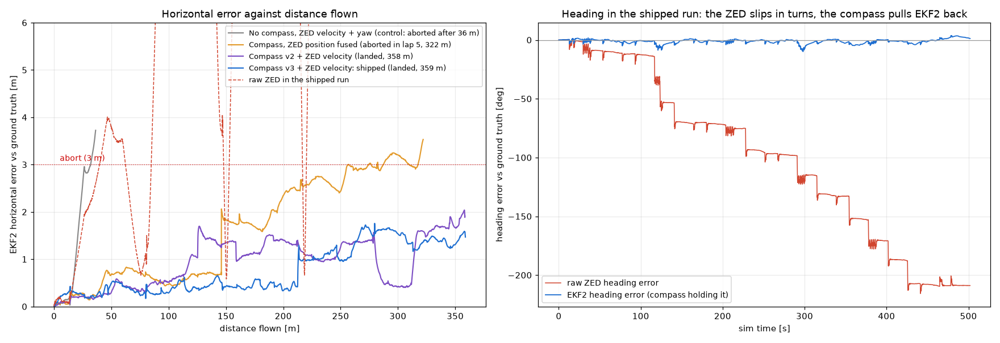
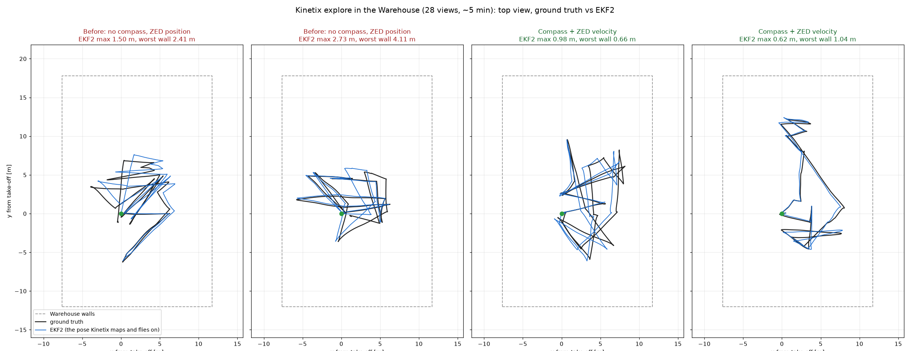
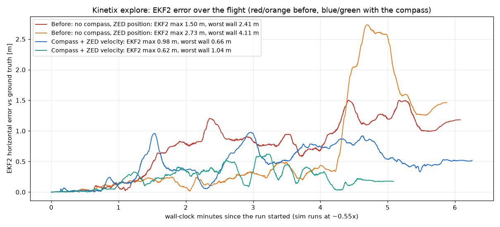

# Long-flight VIO drift: what causes it, and the Manhattan compass that bounds it (2026-10-26)

Kinetix's explore-then-tour flights (8+ min) failed on the sim because EKF2 drifted 0.2-1.4 m in minutes and diverged at minute 14
(kinetix docs/decisions.md ADR-K13). This page is the investigation behind that: a long-flight test that the ~26 m `vio_bench.py`
profile never was, what it showed, the literature review, and the fix that was built and flown.

- Papers: [research/reports/VIO drift fixes for indoor drones.md](research/reports/VIO%20drift%20fixes%20for%20indoor%20drones.md)
  (the report), with the source notes in [research/research_notes/VIO drift fixes for indoor drones/](research/research_notes/VIO%20drift%20fixes%20for%20indoor%20drones/):
  loop closure systems, feeding corrections into EKF2, map-based depth localization, structural (Manhattan) constraints.
- Figures: [figures/](figures/) (`tests/drift_plot.py`): top-down paths, error against distance, heading over time.
- Code: `docker/zed/zed_stack/bridge/compass.py` (Manhattan compass), `bridge/mapcorr.py` (slewed correction), `bridge/odometry.py`
  (`heading`, `pose_source`), settings in `docker/zed/zed.yaml` `px4_bridge.odometry`.
- Tests: `tests/unit/test_compass.py`, `tests/unit/test_mapcorr.py`, `tests/zed_bridge_fake.py` (`./bisg zed test`); flights
  `tests/drift_flight.py`, `tests/yaw_wrap_test.py`. Data: `$ARCHIVE_DIR/drift/20261026-*` (Workstation A: `/opt/docker-archive/drift/`).

## The long-flight test: `tests/drift_flight.py`

Laps of a 12 x 20 m rectangle in the emptied Warehouse at 2 m (x -4..8, y -8..12 from take-off, >= 2 m from the walls; 64 m a lap),
1 m/s, camera along the direction of travel, a stop and a 90 deg turn at each corner and a 360 deg yaw sweep at the start of each lap:
a Kinetix flight's mix of straight legs and in-place turns, repeated so drift has time to grow and places are revisited. It records at
10 Hz ground truth, EKF2, the ZED `odom` (what the bridge used to send), the ZED `pose` (its map frame) and the bridge output
(`mavros/odometry/out`), each as a displacement from its pre-flight value (ZED sources vs ground truth moved to the camera), plus the
bridge status (`bridge.jsonl`), and aborts at 3 m of EKF2 error. Every flight on a fresh sim (`./bisg restart`; copy `/tmp/drift/*`
out of `bisg-ros` before the next restart, which recreates the container).

```
./bisg restart
docker exec bisg-ros bash -lc 'source /opt/ros/jazzy/setup.bash; python3 /workspace/tests/drift_flight.py --out /tmp/drift/run'
docker cp bisg-ros:/tmp/drift/run $ARCHIVE_DIR/drift/$(date +%Y%m%d)-run
```

## What drifts: the ZED's heading, in turns, away from the take-off spot

The shipped configuration (bridge sends the ZED `odom`, EKF2 fuses its position, velocity and yaw: `EKF2_EV_CTRL 13`) aborted
inside the first lap (run `base1`, 26 m): EKF2 3.7 m and 17 deg off, the raw ZED 3.8 m and 16 deg. EKF2 follows the ZED to the
centimetre (no magnetometer, no GPS: nothing else measures heading). The heading error came in **steps during in-place turns**, not
as smooth drift: the first 90 deg turn at the west end of the room left -7.8 deg, later ones 2-8 deg each; every metre flown after
that adds sin(error) of cross-track error (~0.2 m/m at 12 deg). In the longer runs below, the raw ZED heading slid by 115-209 deg in total (unwrapped)
after 4-5 laps (20-75 deg a lap, nearly always negative) and its position 20-36 m.

Where, not how fast: the same turns at the take-off spot are clean. `tests/yaw_wrap_test.py` (hover at 2 m at take-off, 23 turns
of 80-170 deg, 8 of them through +-180 deg) added 0.07 deg per turn on average (max 0.34), and the 2026-10-23 `vio check` 0.03-0.19
deg per 90 deg step. The slips are in the south-west part of the room (turning away from the west wall 3.6 m off, at 2 m height),
and they come with position jumps: in one 360 deg sweep (run `compass3`, 0.3 m of motion) the ZED slipped 35 deg and its position
jumped ~1.2 m. A first suspicion, a quaternion sign flip at +-180 deg in the IMU fed to the stream (`patches-isaac-ext/0001`), is
ruled out by that test. So this is the SDK's GEN_3 tracking losing itself in some views even with the 120 Hz IMU, a tracking event
of the kind vio.md describes, much more frequent on these long flights than on the bench profile. The real ZED Mini (400 Hz IMU with
real noise, real texture) may or may not do the same; the fix below does not depend on why.

## Research (papers: research/reports/VIO drift fixes for indoor drones.md)

Four questions, four note files, one report. What decided the design:
- **Heading is the lever.** With no magnetometer yaw is the one unobservable rotation, and position error follows from it (OPVO,
  BMVC 2017: rotation drift is the main source of VO position error; VINS-Mono's pose graph is 4-DoF for the same reason).
  StructVIO (T-RO 2019) cut indoor drift from 1.08 % to 0.29 % of distance with a structural heading prior.
- **Rooms give an absolute heading for free** (Manhattan world): Straub et al. (IROS 2015) estimate the room's rotation from depth
  in ~20 ms and hold < 2.8 deg RMSE against Vicon over 4.5 min (IMU alone: 8.5 deg and drifting); LPVO / L-SLAM (ICRA / ECCV 2018)
  show the drift-free rotation turns VO drift into < 0.1-0.7 % of distance; Doer & Trommer (ICINS 2021) fly a Manhattan yaw aid in
  an EKF on drones. With gravity known, one wall in view is enough.
- **Loop closure and map registration need a revisit** (ORB-SLAM3, cuVSLAM: 30-60 % less error, on revisiting runs only; Kimera got
  worse in small rooms; false loops are catastrophic without outlier rejection). An exploring drone rarely revisits. Kept for later.
- **How a correction reaches EKF2 matters.** PX4 v1.17 has no gradual path for an EV position offset without GNSS (its EV bias
  estimator only runs with GNSS): a step is fused through the gate as a velocity transient, or rejected for 1 s then reset to, five
  times at most in the air. MAVROS 2.16 never sets the ODOMETRY `reset_counter`, so EKF2 cannot be told about a jump. The ZED
  wrapper's default `reset_odom_with_loop_closure: true` would make `odom` itself jump at each loop closure (relevant if
  `area_memory` is switched on). Hence the correction layer below: corrections reach EKF2 as smooth motion.

## The fix: a Manhattan compass and a slewed correction in the zed-bridge

`px4_bridge.odometry.heading: manhattan` (`bridge/compass.py`, `bridge/mapcorr.py`):
1. **Room axis per depth image** (10 per second, 8 ms each): the decimated depth (every 4th pixel) is back-projected and rotated into
   the odometry frame with the camera's gravity-aligned orientation (paired with the odom sample of the same stamp); the points
   0.3-4 m above the camera (walls, columns, no floor) are projected on the horizontal plane, and a 1 deg then 0.1 deg search finds
   the rotation that makes their x and y histograms sharpest (soft 10 cm bins, weights 1/z^2). Every point votes, so the noise of a
   wall 12 m away averages out.
2. **Drift** = (room axis now) - (room axis on the ground at start, median of 10 views), median of the last 3 accepted views, each
   unwrapped against the current estimate (a measurement only knows the drift modulo 90 deg; folding against 0 flipped a -63 deg
   drift to +27 deg in the first flight). Views are accepted when the best axis scores >= 2x the median axis and >= 500 points
   remain, and only while the yaw rate is < 30 deg/s (each view is paired with the odometry sample of its own stamp, so turning
   does not skew it).
3. **Correction**: out = C o odom with C's yaw moving towards -drift at <= 30 deg/s, pivoting about the current position (the
   position does not jump; later motion is rotated right). EKF2 sees a smooth heading change of at most 1 deg per sample.
4. **EKF2 takes the ZED velocity and yaw, not its position** (`raptor.params`, `EKF2_EV_CTRL 12`): the tracking events that slip
   the heading also jump the position, which the compass cannot see.

Measured in flight (`compass3-vel1`, 506 samples of the bridge status against the raw ZED's true heading error): the compass's drift
estimate is within 1.1 deg (median), 5.5 deg (p90), 21 deg (max, during turns) of the truth, while that error ran to 150+ deg.

What did not work, kept for the record: per-pixel surface normals from the depth gradient with a 4-fold circular mean of their
azimuths (the textbook form of the Straub method). On the sim ZED's depth of a wall 11 m away, normals are tilted by the stereo noise,
only depth edges (columns, window frames) passed as walls, and the axis wandered 1-6 deg between frames of a drone standing still.
The histogram search reads 0.0 +- 0.4 deg on the same frames (truth 0). Unit tests: `test_compass.py` (synthetic box room: axis within
0.2 deg at any yaw, one wall enough, 3 % depth noise, noisy view rejected, drift tracked past 45 deg), `test_mapcorr.py`.

## Results: long flights (one flight per configuration, fresh sim each, 2026-10-26)

`python3 tests/drift_report.py $ARCHIVE_DIR/drift/20261026-*` (JSON: [data/vio_drift_2026-10-26.json](data/vio_drift_2026-10-26.json)).
Compass v2 = 3 views/s, median of 5, measured below 10 deg/s, slewed at 10 deg/s; v3 = 10 views/s, median of 3, below 30 deg/s,
slewed at 30 deg/s (the shipped settings). "Raw ZED" is the ZED `odom` against ground truth in the same flight: what EKF2 followed
before (in `base1` EKF2 matched it to 7 cm).

| run | heading / EKF2 params | outcome | flown | EKF2 h max / RMS / final | EKF2 yaw final | raw ZED h max | raw ZED yaw final (wrapped to +-180) |
|---|---|---|---|---|---|---|---|
| base1 (raw data lost: `./bisg restart` recreated `bisg-ros`; numbers from the run log) | none; shipped | aborted | 26 m | 3.71 / 1.89 / 3.71 m | -17.1 deg | 3.8 m | -16 deg |
| compass1 (v1: folded against 0, 3 deg/s; data lost) | manhattan v1; shipped | aborted | 67 m | 3.35 / 1.38 / 3.35 m | -15.9 deg | 17.2 m | -62 deg |
| compass2 | manhattan v2; shipped | aborted | 20 m | 3.19 / 0.65 / 3.19 m | -33.9 deg | 3.3 m | -35 deg |
| compass3 | manhattan v2; shipped | aborted | 322 m | 3.53 / 1.91 / 3.53 m | -5.2 deg | 33.8 m | -169 deg |
| vel-only1 (control) | none; EKF2_EV_CTRL 12 | aborted | 36 m | 3.73 / 1.57 / 3.73 m | -19.0 deg | 4.4 m | -17 deg |
| compass-vel1 | manhattan v2; EKF2_EV_CTRL 12 | **landed** | 358 m | 2.04 / 1.11 / 1.89 m | +2.3 deg | 36.0 m | -174 deg |
| compass-vel-eva1 | manhattan v2; EKF2_EV_CTRL 12, EKF2_EVA_NOISE 0.001 | aborted on the way home | 350 m | 3.50 / 1.69 / 3.50 m | -10.9 deg | 22.3 m | -115 deg |
| **compass3-vel1** | manhattan v3; EKF2_EV_CTRL 12 | **landed** | 359 m | **1.76 / 0.93 / 1.47 m** | +1.3 deg | 40.7 m | +151 deg |

EKF2 horizontal error at each lap end (m), distance flown in brackets:

| run | lap 1 | lap 2 | lap 3 | lap 4 | lap 5 |
|---|---|---|---|---|---|
| compass3 | 0.64 (79) | 0.68 (145) | 2.46 (214) | 2.93 (281) | - |
| compass-vel1 | 0.32 (79) | 1.27 (145) | 1.31 (211) | 1.40 (277) | 1.66 (344) |
| compass-vel-eva1 | 0.74 (79) | 1.43 (144) | 2.14 (211) | 2.12 (276) | 2.37 (342) |
| compass3-vel1 | 0.29 (79) | 0.51 (146) | 0.42 (212) | 1.50 (279) | 1.24 (345) |

What the flights show (n = 1 per configuration: the SDK events are random, so read the large differences only):
- **The compass is what makes the long flight possible.** Without it every configuration aborted at 3 m inside the first 26-36 m
  (heading -16 to -19 deg). With it, EKF2's heading stayed within a few degrees while the raw ZED's slid by 115-209 deg over
  the same flights; in `compass3-vel1` EKF2's heading error never exceeded 9.9 deg (v2: 33 deg, while a slip was still being removed).
- **The compass alone is not enough while EKF2 fuses the ZED position** (`compass3`: 4 laps, then aborted): the tracking events
  that slip the heading also jump the position (1.2 m in one 360 deg sweep), and the compass only fixes the heading. Fusing the ZED
  velocity + yaw only (`EKF2_EV_CTRL 12`) keeps the position jumps out; on its own (`vel-only1`) it fails just as fast as the
  shipped setup, so the two belong together.
- **Speed of the correction matters**: v3 (correction within ~1 s of a slip, measured during turns) vs v2 (~4 s, only after the
  turn, while the drone already flies the next leg with the wrong heading): EKF2 0.29-0.51 m over the first 212 m vs 0.32-1.31 m.
- A tighter EKF2 heading (`EKF2_EVA_NOISE 0.001`, sigma ~1.8 deg with the v1.17 variance quirk) did not help; 0.01 stays.
- **What is left**: EKF2's error grows in jumps during in-place turns, when the ZED loses itself, and its *velocity* is wrong too
  (lap 4 of `compass3-vel1`: +0.9 m during one 360 deg sweep with 1.5 m of real motion). About 0.4 % of distance flown.




## Results: Kinetix explore in the Warehouse (the flight that failed on 2026-10-24)

`kinetix run --scene config/scenes/warehouse_room.yaml --method tour --rig mavros --explore` from `gcs-kinetix`, fresh sim each,
same Kinetix code (with the 2026-10-26 NBV fixes). EKF2 vs ground truth from each run's rosbag (`mavros/local_position/pose` vs
`state/pose`, offset at take-off); wall error is Kinetix's own fit vs the room (`explore/report.json`). Kinetix runs in
`kinetix/runs/20261026-*_warehouse_room_tour_mavros_s0`.

| run | setup | EKF2 h mean / max / final | EKF2 mean yaw error | fitted room (true 19.3 x 29.8 x 9.0) | worst wall |
|---|---|---|---|---|---|
| 044419 | shipped until now (no compass, `EKF2_EV_CTRL 13`) | 0.76 / 1.50 / 1.18 m | 5.2 deg | 22.2 x 28.1 x 9.1 m | 2.41 m |
| 051036 | shipped until now | 0.64 / 2.73 / 1.46 m | 4.1 deg (a 17 deg slip in minute 4) | 20.4 x 26.1 x 9.1 m | 4.11 m |
| 041403 | compass v3 + `EKF2_EV_CTRL 12` | 0.47 / 0.98 / 0.52 m | 2.3 deg | 20.2 x 30.2 x 9.2 m | 0.66 m |
| 045349 | compass v3 + `EKF2_EV_CTRL 12` | **0.23 / 0.62 / 0.17 m** | 2.3 deg | 20.4 x 31.4 x 9.0 m | 1.04 m |
| 042337 | compass v3 + `EKF2_EV_CTRL 12` + `turn_vel_sigma 1.0` | 0.70 / 1.37 / 1.06 m | 1.6 deg | 21.1 x 30.4 x 9.2 m | 1.29 m |
| (2026-10-24 223640, older Kinetix code) | shipped until now | 0.40 / 1.16 / 0.16 m | 4.1 deg | 20.8 x 31.1 x 9.1 m | 1.27 m |

The two setups do not overlap in two flights each: EKF2 max 0.62-0.98 m vs 1.50-2.73 m, worst wall 0.66-1.04 m vs 2.41-4.11 m.
No run toured: every exploration stopped at its 20-view budget with a wall or the floor seen < 10 % (the level camera's limit in a
9 m hall, already in Kinetix's NBV benchmark), and Kinetix landed instead of touring an untrusted fit. The walls stay ~1 m off with
EKF2 at ~0.2-0.5 m: the rest is the sim ZED's depth at range (ADR-K13: it reads ~10 % short at 8-15 m), not the pose.




Tried and not kept: **de-weighting the ZED velocity in turns** (`turn_vel_sigma`, the twist covariance at 1 m/s while yawing faster
than 20 deg/s, so EKF2 leans on flow + IMU): worse in its one Kinetix flight (0.70 m mean vs 0.23-0.47). The option stays, off.

## What ships (2026-10-26)

- **Sim default**: zed.yaml `sim:` `heading: manhattan` + `docker/sim/sim.yaml` `px4_params: [raptor]`
  (`EKF2_EV_CTRL 12`). `./bisg vio check` on it: **PASS** (`$ARCHIVE_DIR/vio_bench/20261026-071807-stallman2`: latency +0 ms,
  velocity scale 0.999 / 0.998, lever arm 2.3 cm, worst EKF2 0.155 m vs the 0.25 m gate; 7.8 cm on 2026-10-23 with the position
  fused: on a 26 m bench flight velocity fusion costs that, as in the 2026-10-15 ablation, and buys the long flights above). `tests/vio_bench.yaml`: `calibrated` is this mode, the
  ablation `ev_position` puts the ZED position back (13).
- **Real drone unchanged** (zed.yaml main block `heading: none`, Pixracer params with `EKF2_EV_CTRL 13`): the compass needs a check on
  the real camera first (its depth is noisier at range, real rooms are less Manhattan, and the real ZED with its 400 Hz IMU may not
  slip at all). Check: hover, yaw 360 deg, compare `zed_stack/status` `compass.drift_deg` with the ZED's own yaw at the start heading.
- **Not for every room**: the compass assumes walls on two orthogonal directions. A round, angled or cluttered room gives views
  that fail the sharpness gate (they are skipped), but a room with two wall families at, say, 60 deg would bias it: Atlanta-world
  handling (several headings, StructVIO) is not built.

## Open, in the order the research ranks them

1. **Position from the walls** (L-SLAM style: once the heading is fixed, each wall is a 1-D landmark along its normal). Not built:
   the sim ZED's depth reads ~10 % short at 8-15 m (ADR-K13), so wall positions from far returns would inject errors as large as the
   drift. Needs the depth bias understood first, then near walls only (< 5 m).
2. **Loop closure** (`area_memory` + `pose_source: map`, built, not flown): needs `reset_odom_with_loop_closure: false` in the wrapper
   config first (default true: `odom` jumps to the origin at each loop closure), and is exclusive with the compass in the bridge today
   (the compass owns the heading). Useful for revisits and repeat missions (`.area` of a site), not for first exploration.
3. **Why the sim ZED slips** where it does (south-west of the Warehouse, turning away from the west wall at 2 m): an SDK question
   for Stereolabs (GEN_3 with the streamed 120 Hz IMU), with `tests/yaw_wrap_test.py` as the clean-hover reference.
4. A MAVROS `reset_counter` (patch odom.cpp) only if a correction must ever be a step.
